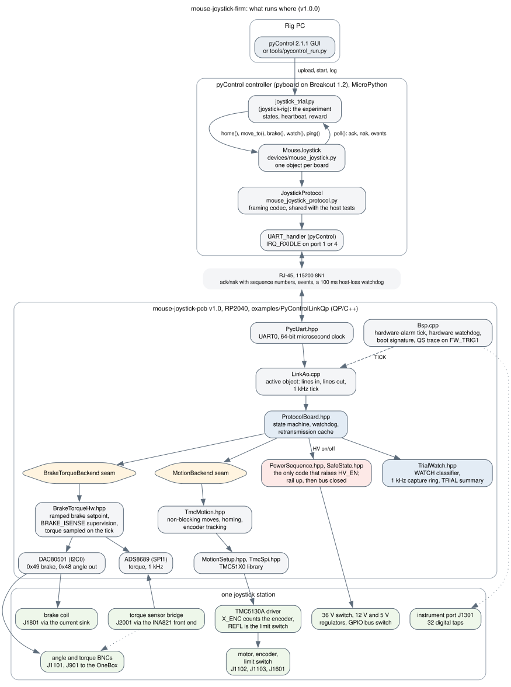

# mouse-joystick-firm

Firmware for [mouse-joystick-pcb](https://github.com/peterpolidoro/mouse-joystick-pcb):
an RP2040 driving one TMC5130A stepper controller, exposed to a pyControl host
over one UART. One board, one joystick axis. Two of these boards serve the
rig's two joysticks.

The board repository owns every electrical fact this firmware depends on, the
[UART protocol](https://github.com/peterpolidoro/mouse-joystick-pcb/blob/main/docs/uart-protocol.md)
pyControl speaks to the board, and the
[bring-up log](https://github.com/peterpolidoro/mouse-joystick-pcb/blob/main/docs/bringup-log.md)
where every measurement is recorded per board serial. The driver library is
[TMC51X0](https://github.com/janelia-arduino/TMC51X0).

**Status, October 2026:** four pcb v1.0 boards run this firmware on two
rigs. Rig 1 at the lab bench (installed 2026-10-09) has units A and B, the
right and left joysticks; the verification rig at Peter's desk (since
2026-10-12) has units C and D, where firmware and task changes run before
they reach Rig 1. Every board passed the staged bench bring-up below and
ran the rig's trial task end to end through pyControl; the delivery build is
`examples/PyControlLinkQp` for the `mouse_joystick_qp_rev2` environment.
Each stage's procedure and findings are in `docs/`; the per-session record
is [`evidence/`](evidence/README.md). The delivered state is tagged
`v1.0.0` (2026-10-13); the installed boards report the commits they were
built from (`51322e7-dirty`, `316f802-dirty`, functionally the same code)
until they are reflashed from the tag.

## Read This First

| If you | Read |
| --- | --- |
| run sessions on the rig | the researcher guide in the rig's repository, then [the glossary](docs/glossary.md) for the words in the log |
| want to know how the firmware is organised and what talks to what | [Architecture](docs/architecture.md), with the trial and power diagrams |
| need to know which code drives which circuit, connector or part | [Circuit-to-code map](docs/circuit-code-map.md) |
| write or change a pyControl task | [The pyControl device class](docs/pycontrol-api.md) and [`pycontrol/README.md`](pycontrol/README.md) |
| build, flash or bring up a board | the rest of this README, then `docs/rp2040-bringup.md`, `docs/motion-bringup.md`, `docs/brake-torque-bringup.md` |



The pin map is verified against PCB git tag **v0.1**, the revision manufactured
as rev 0. Tags v0.1 and v0.2 have byte-identical RP2040 pad-to-net maps.

## Quick Start

Everything runs through [pixi](https://pixi.sh), which installs PlatformIO,
Python and the RP2040 toolchain into the repository on Linux, macOS and
Windows; nothing else has to be installed. The commands are the same on every
platform apart from the serial port name (`/dev/ttyACM0`, `/dev/cu.usbmodem…`
or `COM3`; `pixi run ports` lists them). On Linux, install PlatformIO's udev
rules once (`make udev-rules`) so the port is usable without root.

```sh
pixi install                                    # resolve the firmware environment
pixi run build                                  # compile examples/RP2040SelfTest
pixi run test                                   # host-native tests, no board needed (Linux and macOS)

# with the board on USB and the 36 V input UNPLUGGED:
pixi run upload examples/RP2040SelfTest mouse_joystick_rev2 /dev/ttyACM0
pixi run monitor /dev/ttyACM0
```

`pixi run build`, `upload`, `flash` and `rebuild` take the example directory,
the environment and, for uploads, the port as positional arguments; the
defaults are `examples/RP2040SelfTest` and `mouse_joystick`, which is the
**pcb v0.1/v0.2** build. A v1.0 board is `mouse_joystick_rev2` (see
[Environments](#environments)). The Makefile is a thin wrapper over the same
tasks for a shell with `make`: `make upload EXAMPLE=… ENV=… PORT=…`.

### Reprogramming a v1.0 board

The firmware the rig runs is `examples/PyControlLinkQp` built for
`mouse_joystick_qp_rev2`:

```sh
pixi run upload examples/PyControlLinkQp mouse_joystick_qp_rev2 /dev/ttyACM0
```

A board already running this firmware reboots into the bootloader on the
1200 baud touch, so nothing has to be pressed. A blank or unresponsive board
has to be put into BOOTSEL by hand, which on this board needs both USB and the
pyControl cable unplugged first; [`docs/rp2040-bringup.md`](docs/rp2040-bringup.md)
has the procedure. If `picotool` refuses to write, copy the built UF2,
`.pio/build/examples/PyControlLinkQp/mouse_joystick_qp_rev2/firmware.uf2`,
onto the `RPI-RP2` drive the bootloader presents, or load it with
`picotool load -x firmware.uf2 --bus B --address N` (the RP2040 ROM
bootloader reports the same USB serial on every board, so with two boards in
BOOTSEL the USB address is what selects one). Two of the four v1.0 boards so
far ignore the 1200 baud touch under this build and need the button every
time. The board announces its firmware version in the protocol's `ID` reply.

On USB a board enumerates as manufacturer `Janelia Research Campus`, product
`mouse-joystick-pcb`, with the RP2040 flash unique id as its serial, so on
Linux `/dev/serial/by-id/usb-Janelia_Research_Campus_mouse-joystick-pcb_<serial>-if00`
names a specific board regardless of plug order. Boards flashed before
2026-10-12 report the manufacturer as `Orb Weaver` until reflashed.

### The pyControl host side

The pyControl host side is a **separate pixi environment** with no PlatformIO
in it, so building firmware never downloads Qt and running the GUI never
downloads a toolchain:

```sh
pixi install -e pycontrol                       # numpy, pyserial, pyqtgraph, PyQt6, pytest
pixi run -e pycontrol pycontrol-check           # verify pyControl's dependency gate
pixi run -e pycontrol pycontrol-test            # host-side tests, no board and no pyControl needed

export PYCONTROL_DIR=/path/to/pycontrol-code    # a pyControl 2.1.1 checkout
pixi run -e pycontrol pycontrol-link            # point that checkout at pycontrol/
pixi run -e pycontrol pycontrol-run             # run a task on the pyboard through pyControl's own board API, no GUI (Gate E)
pixi run -e pycontrol gui                       # launch the pyControl GUI
```

`pycontrol-check` exists because **pyControl fails its own dependency check
silently**: `pyControl_GUI.pyw` catches the exception, writes `ErrorLog.txt`,
and exits. The symptom is a GUI that does not open with nothing on the
terminal. [`pycontrol/README.md`](pycontrol/README.md) covers the device
class, what the rig's controller carries and how to set up another one.

`tools/sim_task.py` runs a pyControl task on the host against the board
simulator, with a chosen reply dropped or corrupted, so a task's handling of
a lost line can be exercised without a pyboard or a board:

```sh
pixi run -e pycontrol python tools/sim_task.py path/to/joystick_trial.py drop-trial 1
```

## Bring-Up Is Staged

The board has two power domains with a bus switch between the MCU and everything
else. The stages follow that boundary:

| Stage | What runs | 36 V | Bus switch | Driver | Status |
|-------|-----------|------|-----------|--------|--------|
| 1 | RP2040 alone | absent | isolated | disabled | `examples/RP2040SelfTest` — **passed** |
| 2 | TMC5130A register reads | applied | closed | disabled | `examples/TMC5130Communication` — **passed** |
| 3 | Motion, encoder, homing | applied | closed | enabled | `examples/MotionAndHoming` — **passed** |
| 4 | pyControl UART protocol | applied | closed | as needed | `examples/PyControlLink` — **passed on hardware** 2026-09-03 |
| 5 | Analog angle output | applied | closed | untouched | `examples/AngleOutput` — writes verified 2026-09-09; **output not yet measured, needs a DMM** |
| A4/A5 | Brake sink, torque bridge (pcb v1.0) | applied | closed | untouched | `examples/BrakeAndTorque` — **passed on v1.0 unit A 2026-10-06**: brake 0–48.80 mA linear, ADS8689 reading at 95–112 µV rms; see `docs/brake-torque-bringup.md` |

**Stage 5 needs a v0.3 or later board and `env:mouse_joystick_rev1`.** It also
needs a meter: `ANGLE_OUT` reaches no RP2040 ADC, and over SPI the DAC cannot be
read back either, so nothing on the board can see its own analog output.

**Stage 1 has no way to raise `HV_EN` and no way to enable the bus switch.** That
is deliberate, not an omission: until the MCU is proven there is no reason to put
36 V near it, and an MCU pin driving into an unpowered TMC5130A back-powers a
dead rail through its ESD clamps.

**Stage 2 has no way to enable the driver.** It reads registers with
`~{TMC_DRV_EN}` held high throughout and writes nothing, so no current can reach
the motor. Enabling the driver depends on the current-sense decision — `vsense = 1`
with the 0.15 Ω shunts — which belongs to stage 3.

`src/PowerSequence.hpp` is the only file that raises `HV_EN`, and it enforces the
one safe ordering: rail up before the bus closes, bus open before the rail drops.

## What Stage 1 Actually Checks

Run `examples/RP2040SelfTest`, read the USB serial monitor. Roughly twenty
checks, each reporting a number or a level:

- **Boot signature and heartbeat** — a distinctive pattern on the InstrumentPort
  triggers before Serial comes up, then a 1 Hz square wave forever after. This is
  the only proof that the RP2040 is running your code that does not depend on
  USB. Watch LA5032 channels 16 and 17.
- **Identity** — the flash unique id, which *is* this board's serial. Calibration
  belongs to the serial, not to a joystick position.
- **Clocks** — every derived clock, plus `clk_sys` measured against the crystal.
  The crystal's own absolute proof is that USB enumerated at all; the `k` command
  measures it against your host clock if you want a number.
- **QSPI flash** — a real `0x4B` read proves the W25Q128 responds, and an address
  aliasing probe at +2, +4 and +8 MiB proves the part is really 16 MiB rather
  than trusting the BOM.
- **RAM** — a four-pattern walk over a 16 KiB heap block.
- **Board pull resistors** — `GP9`, `GP24`, `GP1` and `GP29` read with internal
  pulls off, so each level comes from a board resistor. A failure here is a
  missing or misplaced part, not firmware.
- **Spare pads** — the nine unrouted GPIOs pulled both ways. A pad that will not
  move is shorted.
- **ADC** — the switched-rail sense (expected ~0 V), the 36 V current sense
  (expected ~0 V), and the die temperature, which proves the ADC and `ADC_AVDD`.

Then an interactive menu: re-run, read the ADC, pulse the InstrumentPort
triggers, stream clock ticks, try a pyControl UART loopback, or reboot into
BOOTSEL.

## Things About This Board That Will Bite You

Collected here because none of them are guessable from the code:

- **There are no LEDs.** Not one. USB CDC and the two `FW_TRIG` pins on
  InstrumentPort-40 are the entire observable surface. `LED_BUILTIN` resolves to
  GPIO 25, which here is `FW_TRIG0`.
- **There are no test points, anywhere.** Reach a signal at a component pin or
  through InstrumentPort-40.
- **Rev 0 has no SWD header and no `RUN` connection.** No debugger during
  bring-up. BOOTSEL recovery needs USB *and* pyControl unplugged, because the MCU
  domain is ORed from both.
- **`Serial2` and `Wire1` must never be called.** The `generic` board definition
  maps them onto GPIO 8/9 and 26/27, which on this board are `TMC_DIAG1`,
  `~{BUS_SW_EN}`, the rail sense ADC, and a spare pad.
- **The GPIO bus is isolated at reset and only a pull-up keeps it that way.**
  R601 7.87 kΩ. All four `SN74CB3Q3245` packages run from the always-on rail, so
  `Ioff` never engages — the enable pin is the only mechanism, not the inner of
  two.
- **`HV_DIAG_EN` must never idle high.** Held high it leaks ~240 µA into
  `+36V_SW` through the switch's open-load detection; the rail creeps past the
  buck's minimum input in about three seconds and the switched domain hiccups
  instead of staying off.
- **`vsense = 1` with the 0.15 Ω shunts.** It resets to 0, which at 0.15 Ω drives
  roughly 1.8× the intended current. Stage 3 sets and reads it back
  before enabling the driver.
- **The encoder and limit switch never reach a GPIO,** on any revision. Position
  comes from the driver's `X_ENC`/`XACTUAL` over SPI.

## Stage 2: What It Checks

Run `examples/TMC5130Communication` with 36 V on `J201`. It is interactive and
starts powered down — send `s` to begin, `x` to power down.

1. Confirms `+3.3V_SW` is genuinely dead before raising anything, and refuses to
   continue if it is not.
2. Raises `HV_EN` and measures how long `+3.3V_SW` takes to come up.
3. Reads the 36 V switch's own diagnostics, raising `HV_DIAG_EN` only for the
   duration of the read and lowering it again.
4. **Then** closes the GPIO isolation bus switch.
5. Reads `IOIN`, `GSTAT`, `GCONF`, `CHOPCONF`, `DRV_STATUS`, `XACTUAL` and
   `X_ENC`, printing every datagram byte so the serial log can be compared
   against a logic analyser capture.

The check that matters most is `IOIN` bit 4, `DRV_ENN`: it reads back the level
firmware drives on `GP3` *through the bus switch*, and nothing else in the test
proves that path. Expected `IOIN` on this board is `0x11000010`, with bit 7 free
because `SWCOMP_IN` is a comparator output.

Two failure signatures are called out explicitly rather than left as "SPI
failed": all bytes `0x00` means CIPO is undriven, which on this board points at
the bus switch enable, then `+3.3V_SW` at the driver's `VCC_IO`, then CS. All
bytes `0xFF` means CIPO is stuck high, which the board's 10 kΩ pull-down should
prevent.

## Pin Map

`src/BoardPins.hpp` is the single source of truth and carries the reasoning.
Summary:

| GPIO | Net | Function | Isolated |
|------|-----|----------|----------|
| 0 | `PYC_UART_TX` | pyControl UART0 TX | no |
| 1 | `PYC_UART_RX` | pyControl UART0 RX, 10 kΩ pull-up | no |
| 2 | `~{TMC_CS}` | driver chip select | yes |
| 3 | `~{TMC_DRV_EN}` | driver enable, active low | yes |
| 4 | `TMC_SPI_CIPO` | SPI0 RX | yes |
| 5 | `TMC_DIAG0` | driver diagnostic 0 | yes |
| 6 | `TMC_SPI_SCK` | SPI0 SCK | yes |
| 7 | `TMC_SPI_COPI` | SPI0 TX | yes |
| 8 | `TMC_DIAG1` | driver diagnostic 1 | yes |
| 9 | `~{BUS_SW_EN}` | GPIO isolation enable, active low | — |
| 10, 11, 13 | `DAC_SPI_*`, `~{DAC_CS}` | rev 1 angle DAC, SPI1. **Unrouted on rev 0** | yes |
| 14 | `HV_DIAG_EN` | 36 V switch diagnostics enable | no |
| 19 | `HV_EN` | 36 V input switch enable | no |
| 21, 25 | `FW_TRIG1`, `FW_TRIG0` | firmware timing markers | no |
| 24 | `~{INSTR_BUF_OE}` | instrumentation buffer enable | no |
| 26 | `SW_RAIL_SENSE_DIV_2` | `+3.3V_SW` ÷2, ADC0 | no |
| 28 | `HV_SNS` | 36 V load current sense, ADC2 | no |
| 29 | `~{HV_FAULT}` | 36 V switch fault, 10 kΩ pull-up | no |
| 12, 15, 16, 17, 18, 20, 22, 23, 27 | — | spare, routed nowhere | — |

Rev 0 and rev 1 share this allocation by design. No rev 0 pin moved. The only
firmware-visible difference is GP10/GP11/GP13, unrouted on rev 0 and therefore
folded into the spare-pad test — see `MJ_BOARD_REV`.

**pcb v1.0 is `MJ_BOARD_REV=2` and moves pins.** Read off footprint `U601`
(the RP2040 moved into the combined MCU block; `U501` is now the 36 V switch)
in the board file, which is unchanged from commit `d5ae4b0` through the
fabrication package and HEAD. GP0–GP9, GP14, GP19, GP21, GP25, GP26 and GP28
are as above. The rest:

| GPIO | v1.0 net | Function | Isolated |
|------|----------|----------|----------|
| 10, 11, 12 | `TQ_SPI_SCK`, `TQ_SPI_COPI`, `TQ_SPI_CIPO` | torque ADC ADS8689, SPI1 | yes |
| 13 | `~{BRAKE_FAULT}` | brake current-limiter indication, **input** | yes |
| 15 | `TQ_CONVST_CS` | torque ADC convert-start / chip select, no pull | yes |
| 16, 17 | `DAC_SDA`, `DAC_SCL` | I2C0 to both DACs: angle 0x48, brake 0x49; 4.7 kΩ pull-ups both sides of the switch | yes |
| 18 | `TQ_CAL_EN` | torque shunt-calibration switch, must idle low | yes |
| 23 | `~{HV_FAULT}` | 36 V switch fault, 10 kΩ pull-up (`R507`) | no |
| 24 | `HV_LATCH` | 36 V switch latch-off select, via `R503` 10 kΩ; low = auto-retry | no |
| 27 | `BRAKE_ISENSE` | brake coil current monitor, 0–1.006 V, ADC1 | no |
| 29 | `ANGLE_OUT_MON` | angle output node, 0–1.650 V, ADC3 | no |
| 20, 22 | — | spare | — |

The instrument port is InstrumentPort-Digital-50 (`J1301`), always enabled,
with `FW_TRIG0`/`FW_TRIG1` on `DIG0`/`DIG1`; there is no `~{INSTR_BUF_OE}`.
Three traps follow directly: **GP24 is an output that configures the 36 V
switch**, not a buffer enable; **GP29 is an ADC input**, so reading it as the
fault line finds no fault, ever; and **GP13 is driven by the brake block**, so
a rev 1 build that closes the bus and drives the old DAC chip select shorts
two outputs. `SafeState::apply()` and `PowerSequence::powerUp()` handle
`HV_LATCH`; nothing else may touch it.

**Reference designators are not stable across revisions.** Automatic annotation
orders by sheet position, so inserting a part rotates everything after it.
`R1901`/`R1902` are 100 Ω pyControl series resistors at v0.1 and 1 kΩ
`HV_EN`/`HV_DIAG_EN` series resistors at v0.3; at v1.0 the 36 V block is
`U501`/`R50x` and `U501` had been the RP2040. Designators quoted in this
repository are **v0.1** designators unless a revision is named; identify parts
by value and net.

## Layout

```
examples/RP2040SelfTest/       stage 1 program
examples/TMC5130Communication/ stage 2: raw SPI, no driver library
examples/MotionAndHoming/      stage 3: motion, encoder, homing, over TMC51X0
examples/PyControlLink/        stage 4: the pyControl UART protocol
examples/AngleOutput/          stage 5: the analog angle output. rev1 only
examples/BrakeAndTorque/       stages A4/A5: the brake current sink and the
                               torque bridge. pcb v1.0 (rev2) only
src/                           board support library
  BoardPins.hpp                GPIO allocation, single source of truth
  Conversions.hpp              ADC and motion scaling, Arduino-free so the
                               host can test it; also the fitted parts' facts
  DAC80501Registers.hpp        DACx0501 register map and output arithmetic.
                               Arduino-free, host tested
  DAC80501Device.hpp           DACx0501 device logic and the GAIN-before-data
                               ordering interlock. Arduino-free, host tested
                               against a fake transport
  DAC80501.hpp                 DACx0501 Arduino transports, SPI and I2C
  ADS8689Registers.hpp         ADS8689 register map, 32-bit framing and
                               transfer function. Arduino-free, host tested
  ADS8689Device.hpp            ADS8689 device logic: range written and read
                               back before any conversion is believed, the
                               two-frame register read. Host tested
  ADS8689.hpp, ADS8689/        the SPI transport with a plain-GPIO CONVST/CS,
                               a SEPARATE library like DAC80501
  DAC80501/                    a SEPARATE library, not board support: this part
                               is placed twice at pcb v1.0 and is intended to
                               be extracted to its own repository once a second
                               consumer exists
  BrakeTorqueBackend.hpp       the seam between the protocol and pcb v1.0's
                               brake sink and torque bridge, with the
                               simulated backend the corpus runs against
  BrakeTorqueHw.hpp            the real one: brake DAC at 0x49 with a ramped
                               setpoint, BRAKE_ISENSE supervision, the
                               ADS8689 sampled on the tick. Firmware only
  SafeState.hpp                safe idle state
  PowerSequence.hpp            the switched rail; the only thing that touches
                               HV_EN
  SelfTest.hpp                 the stage 1 checks
  TmcSpi.hpp                   stage 2's raw datagram layer
  MotionSetup.hpp              stage 3's TMC51X0 glue: this board's facts, and
                               CHOPCONF.vsense, which TMC51X0 cannot express
test/native/                   host tests for the Arduino-free arithmetic
tools/pio_task.py              example selection without editing platformio.ini
tools/circuit_code_map.py      writes docs/circuit-code-map.md from the rig's
                               component registry and the board's records
tools/pycontrol_api_doc.py     writes docs/pycontrol-api.md from the device class
tools/render_diagrams.py       renders docs/diagrams/*.dot to SVG and PNG; the three
                               run together as `make docs`
docs/architecture.md           how the firmware is organised, with the diagrams in
                               docs/diagrams/ (Graphviz sources and rendered SVG)
docs/circuit-code-map.md       generated: which code drives which circuit and part
docs/pycontrol-api.md          generated: the device class's methods and verbs
docs/glossary.md               the words the protocol, the task and the log use
docs/rp2040-bringup.md         stage 1: the procedure, and each failure's meaning
docs/motion-bringup.md         stage 3: the same, plus the rig's measured facts
docs/brake-torque-bringup.md   stages A4/A5: the brake sink and torque bridge
.agents/                       agent guidance and plans
```

The example to build is selected by `PLATFORMIO_SRC_DIR`, not by editing
`platformio.ini`, and each example gets its own build directory so switching
between them does not invalidate a cache. Same arrangement as `TMC51X0`.

## Environments

| Env | Purpose |
|-----|---------|
| `mouse_joystick` | `MJ_BOARD_REV=0`, for pcb **v0.1 and v0.2 only**. Quad-lane `boot2_w25q128jvxq` stage 2 since 2026-10-06 (every env inherits it); see `mouse_joystick_safeflash` for the generic one. |
| `mouse_joystick_safeflash` | Same board on the universal single-lane `boot2_generic_03h` stage 2, which boots regardless of the flash's quad-enable bit: for a first-article board before its flash is proven. Slow XIP: on the link build it cost the 1 kHz sampler most of its budget (bring-up log, "the tick budget attributed"). Not for delivery. |
| `mouse_joystick_rev1` | `MJ_BOARD_REV=1`, for pcb **v0.3 only**, where GP10/GP11/GP13 carry the angle DAC on SPI1. **This is not a future-only env — a v0.3 board needs it.** Building rev 0 against v0.3 drives the spare-pad test onto the DAC's SPI bus and chip select. The check count is the tell: a v0.3 board reporting 27 checks in stage 1 was built with the wrong env; rev 1 reports 24. **Not for v1.0**, where GP13 is an input from the brake block. |
| `mouse_joystick_rev2` | `MJ_BOARD_REV=2`, for pcb **v1.0** (board file `d5ae4b0` through HEAD; no tag yet). I2C DACs on GP16/GP17, torque ADC on SPI1, `~{BRAKE_FAULT}` GP13, `HV_LATCH` GP24, `~{HV_FAULT}` GP23, two spare pads, **20 stage 1 checks**. The transport is chosen by the revision; `MJ_DAC_I2C` is not needed. **On hardware since 2026-10-05** (unit `E4654C159F274534`: stages 1, 2, A3, A6, and A4/A5 on 2026-10-06). Replaces `mouse_joystick_rev1_i2c`, which described a board that never existed. |
| `mouse_joystick_qp` | `examples/PyControlLinkQp` only: the stage-4 protocol inside a QP/C++ active object with a QS trace on `FW_TRIG1`, rev 0, `TmcMotion`, pyControl on UART0. qp-arduino comes from its `v7.3.4` tag on GitHub. |
| `mouse_joystick_qp_rev1` | Same for rev 1. |
| `mouse_joystick_qp_rev2`, `mouse_joystick_qp_rev2_usb` | Same for pcb v1.0, delivery and bench (USB protocol, tick probe) builds. Since 2026-10-06 the brake sink and the torque bridge are driven through `src/BrakeTorqueHw.hpp`: `caps` reports `brake` and `torque`, `BRAKE` ramps the coil and releases the drive once the current has settled, `TQ` answers, torque rides in `STATUS`, the events, `TRIAL` and the capture. |
| `mouse_joystick_qp_sim_usb` | Same application for a board with no 36 V and no host: simulated motion, protocol over USB CDC. How it was first run on the fixture. |
| `native` | host tests. |

### Five Build-System Traps

- **The board support library is declared as `symlink://src/MouseJoystickBoard`,
  not as a bare path.** A bare local path makes PlatformIO *copy* the directory
  into `.pio/libdeps/` and it never refreshes the copy — not on a rebuild, and
  not on `-t clean`. Edits to `src/MouseJoystickBoard/*.cpp` then silently do not
  get compiled and the build succeeds while testing old code. `symlink://`
  requires the library to carry a manifest, which is why
  `src/MouseJoystickBoard/library.json` exists. **`TMC51X0` has the same bare-path
  arrangement and therefore the same trap.**
- **`make test` wipes the firmware build directories.** The native test run uses
  the default build dir and prunes the per-example ones. Harmless, but do not
  read it as a failed build.
- **`pixi run test` deletes the firmware UF2s, so flash BEFORE you test.** This
  is the same trap as the note above, but it bites harder than it reads: the
  artifact is simply gone, and `picotool load` then reports
  `Could not open ...firmware.uf2` — which looks like a tooling failure rather
  than a missing file. Rebuild, then flash.
- **When `picotool` will not write, copy the UF2 to the bootloader drive
  instead.** With the board in BOOTSEL, `cp firmware.uf2 /media/$USER/RPI-RP2/`
  and `sync` works through the bootrom's mass storage and bypasses picotool
  entirely. On 2026-09-10 picotool failed six consecutive writes with
  `The RP2040 device returned an error: <unknown>` while `lsblk` showed the
  `RPI-RP2` drive present at its correct 128 M — the copy succeeded first try.
  **This is a more reliable recovery than retrying picotool.**
- **`lib_ldf_mode = off`, so nothing is discovered by scanning includes.** A
  library that is not named in `lib_deps` is simply not on the include path,
  even a built-in one. The symptom is a `No such file or directory` for a header
  the source plainly includes — `Wire.h`, when `DAC80501` was added and only
  `SPI` was listed. Both `SPI` and `Wire` are named now, on every env, because
  the DAC driver supports either transport regardless of which one a given
  board wires up.

## Recording Results

Measured behaviour goes in
[mouse-joystick-pcb/docs/bringup-log.md](https://github.com/peterpolidoro/mouse-joystick-pcb/blob/main/docs/bringup-log.md),
under the board's serial, as numbers with units. Two boards in one rig are
independently calibrated and independently suspect.

## Verification Evidence

[`evidence/`](evidence/README.md) holds the record of the v1.0 boards'
verification: the console logs, protocol transcripts, pyControl session
outputs, trace analyses and small logic-analyzer captures from every bench
and rig run between the first v1.0 power-up on 2026-10-05 and the installed
rig's first observed experiment on 2026-10-09, with the firmware commit and
board serial of each. The numbers they support are written up in the board
repository's [bring-up log](https://github.com/peterpolidoro/mouse-joystick-pcb/blob/main/docs/bringup-log.md);
the per-board calibration they produced is `src/BoardCalibration.hpp`.

## Related Repositories

- [mouse-joystick-pcb](https://github.com/peterpolidoro/mouse-joystick-pcb): the board, the protocol and the bring-up log.
- [camera-gpio-interface-pcb](https://github.com/peterpolidoro/camera-gpio-interface-pcb): the rig's camera interface board.
- [joystick-rig](https://github.com/sourishmukh/joystick-rig): the rig's pyControl tasks, hardware definition and operating notes.
- [TMC51X0](https://github.com/janelia-arduino/TMC51X0): the stepper driver library.

## Development

[docs/development.md](docs/development.md) covers the sibling repositories
this firmware was developed beside, the logic-analyzer tooling used to watch
the board, and the observability workstream. Agent guidance is in `AGENTS.md`
and `.agents/`.

## License

3-clause BSD; see [LICENSE](LICENSE).

## Citation

[CITATION.cff](CITATION.cff) carries the citation metadata; GitHub renders it
under "Cite this repository".
