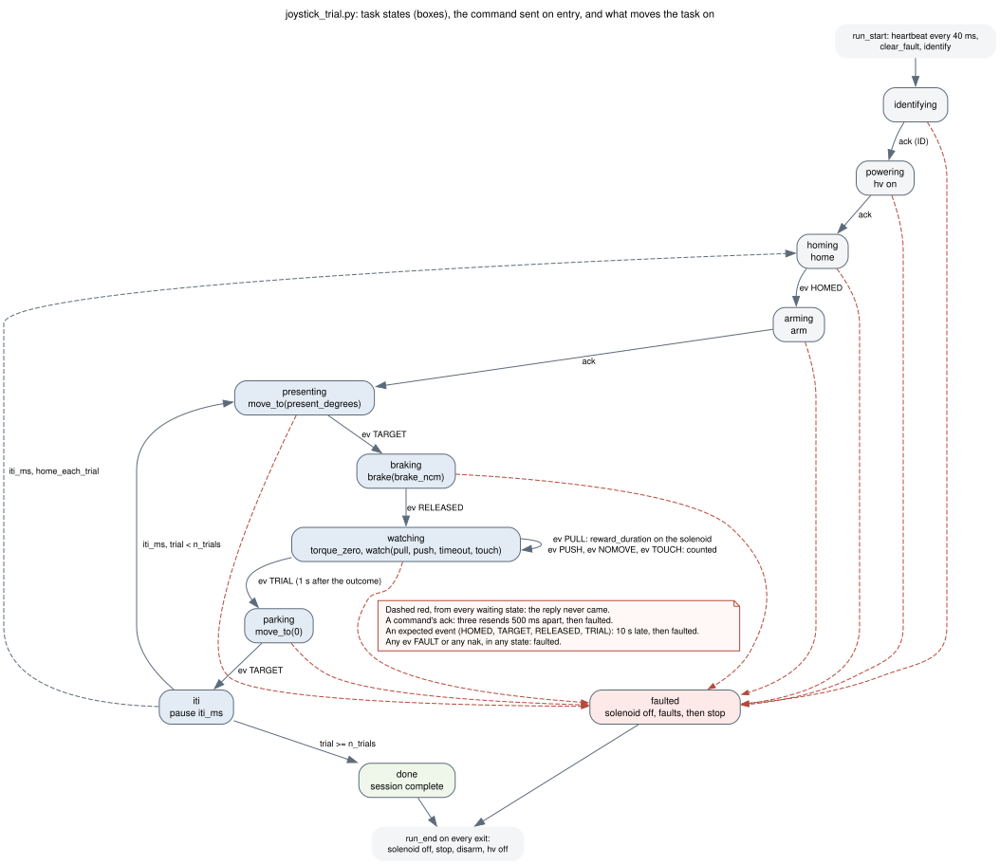
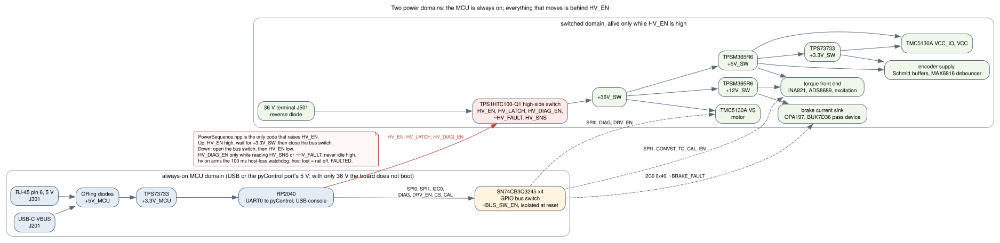

# Architecture

How the firmware is organised, from the pyControl task that owns the
experiment down to the parts of a joystick station, and where each piece
lives in this repository. For what each piece *measures*, see the bring-up
documents; for which part of the rig each piece talks to, the
[circuit-to-code map](circuit-code-map.md).

## Three places, one contract

The experiment runs in three places that share one line protocol
([UART protocol](https://github.com/peterpolidoro/mouse-joystick-pcb/blob/v1.0/docs/uart-protocol.md),
protocol v1, `proto=2` on the wire):

1. **The rig PC** runs pyControl's GUI (or `tools/pycontrol_run.py` without
   it), which uploads the task and the device files to the controller, starts
   a session and records its log.
2. **The pyControl controller**, a pyboard on a Breakout 1.2 running
   MicroPython, runs the task (`joystick_trial.py` in the rig's repository)
   and one `MouseJoystick` object per board (`pycontrol/devices/`). The task
   decides *what* happens: present, release, watch, reward, park. The device
   class turns that into protocol lines and hands back the board's replies and
   events through `poll()`. The [pyControl API page](pycontrol-api.md) lists
   its methods.
3. **The board** runs this firmware. It decides *how* and *when* at a
   precision the controller cannot: homing against the switch, moves with
   encoder tracking, the brake-then-release sequence, classifying a pull or a
   push at 1 kHz, and the safety rules.

The two ends are held to one test corpus
(`pycontrol/tests/fixtures/protocol_cases.txt`): the board half in C++ on the
host, the controller half in Python against the simulator. That is why both
halves live in this one repository and version together, and why the
protocol layer below is written without Arduino.

## The board, layer by layer

| Layer | Files | Role |
| --- | --- | --- |
| Link | `src/PycUart.hpp`, `examples/PyControlLinkQp/Bsp.cpp` | UART0 on the RJ-45 at 115200 8N1; a 64-bit microsecond clock that does not wrap inside a session; the 1 kHz hardware-alarm tick and the hardware watchdog |
| Active object | `examples/PyControlLinkQp/LinkAo.cpp` | One QP/C++ active object: every protocol line and every tick is a run-to-completion step, with a QS trace record leaving on `FW_TRIG1` so a logic analyzer can see what the firmware did without USB |
| Protocol | `src/Protocol.hpp`, `src/ProtocolBoard.hpp` | Framing, sequence numbers, `ack`/`nak`, the state machine, the host-loss watchdog, the retransmission cache. Owns no motion and no hardware |
| Trial | `src/TrialWatch.hpp` | The `WATCH` classifier, the 1 kHz capture ring behind `FETCH`, the per-trial `TRIAL` summary |
| Seams | `src/MotionBackend.hpp`, `src/BrakeTorqueBackend.hpp` | Interfaces the protocol layer drives. Each has a simulated implementation for the host tests and a hardware one for the board |
| Motion | `src/TmcMotion.hpp`, `src/MotionSetup.hpp`, `src/TmcSpi.hpp`, `src/TmcRegisters.hpp` | Non-blocking moves and homing over the TMC51X0 library; the encoder is counted by the TMC5130A and read over SPI, never by a GPIO |
| Brake and torque | `src/BrakeTorqueHw.hpp`, `src/DAC80501*.hpp`, `src/ADS8689*.hpp` | The brake DAC at I2C `0x49` with a ramped setpoint and coil-current supervision; the torque ADC on SPI1 sampled on the tick; the angle DAC at `0x48` |
| Power and safety | `src/PowerSequence.hpp`, `src/SafeState.hpp` | The only code that raises `HV_EN`; the rail comes up before the GPIO bus switch closes and the bus opens before the rail drops |
| Board facts | `src/BoardPins.hpp`, `src/Conversions.hpp`, `src/BoardCalibration.hpp` | Every GPIO number, every scaling constant and the per-board pull sign, each traced to the board file or a measurement |
| Self test | `src/SelfTest.hpp`, `examples/RP2040SelfTest` | Stage 1: the MCU alone, with the switched domain off |

The diagram's hexagons are the seams. Above them the code is testable on the
host; below them it needs the board.

## One trial

The task sends one command per state and waits for one specific reply or
event; the heartbeat's acks are ignored. A reply that never arrives ends the
session rather than hanging it: three resends at 500 ms for a command's ack,
a 10 s deadline for an event. The board's own state machine is the
[protocol's](https://github.com/peterpolidoro/mouse-joystick-pcb/blob/v1.0/docs/uart-protocol.md),
drawn in the board repository:

## Power, and why the firmware is careful about it

The MCU runs from USB or from the pyControl port's 5 V and is always on;
everything that moves runs from the 36 V input behind a high-side switch the
firmware controls. Between the two sits a GPIO bus switch that is isolated at
reset. `PowerSequence` is the only code that raises `HV_EN`, and it does so
in one order: rail up, wait for the switched 3.3 V, close the bus; and the
reverse on the way down. `hv on` also arms the host-loss watchdog: a host
that stops talking for 100 ms gets its rail dropped and a `FAULTED` board,
which is why the task pings every 40 ms.

## Builds

The delivery firmware is `examples/PyControlLinkQp` built for the
`mouse_joystick_qp_rev2` environment; `pixi run upload` flashes it. The
other examples are the bring-up stages, one per power boundary, described
in the README. The build defines the version `ID` reports from `git describe`,
so a board flashed from a clean checkout at `v1.0.0` answers `fw v1.0.0`.
